# Safety Vision

Computer-vision safety monitoring for industrial sites. A local GPU engine watches your cameras and
reports missing protective equipment (helmet, safety vest, safety shoes); a web console shows live
cameras, alarms and events to the operator.

[](https://github.com/pooryakhorsand/safety-vision/actions/workflows/ci.yml)
[](https://github.com/pooryakhorsand/safety-vision/releases)


<!-- TODO(owner): replace pooryakhorsand/safety-vision in the badges and add a License badge once LICENSE is chosen. -->

<!-- TODO(owner): add the hero GIF -->
<p align="center">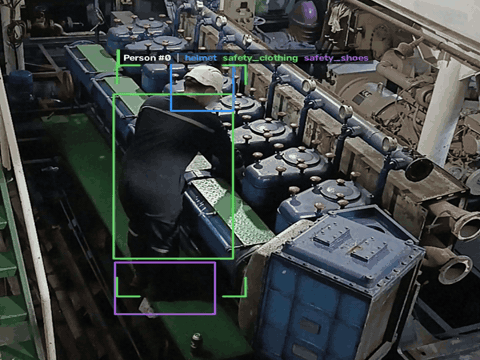</p>
### Example locations

<p align="center">
  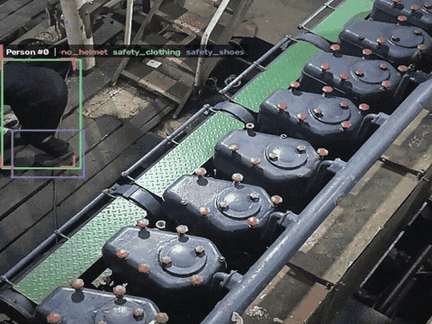
</p>

<p align="center">
  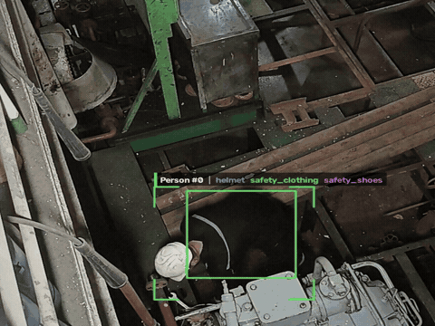
</p>

<p align="center">
  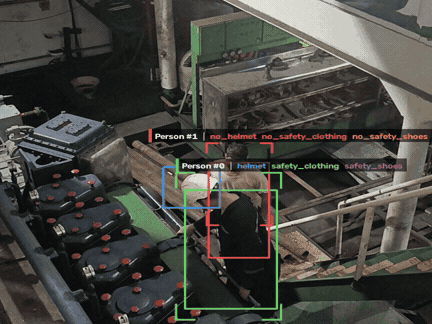
</p>

<p align="center">
  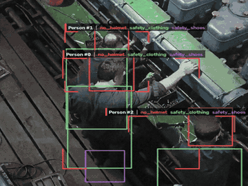
</p>


## What it does

- Detects people and checks that each one wears a helmet, a safety vest and safety shoes.
- Turns a violation into **one event** with a start, an end, the camera and a snapshot, not one row per frame.
- Merges repeated violations by the same person within a few minutes into one event with an occurrence count.
- Lets the operator acknowledge alarms, say who the person is, filter, export CSV and print reports.
- Runs fully offline on the site's own computer, as a Windows desktop app or from source.

## What it does NOT do

- No face recognition. The engine never sends a name; only an operator can assign a person to an event.
- No individual productivity scoring.
- No cloud service: video never leaves the machine that runs the engine.

## Screenshots

| | |
|---|---|
| 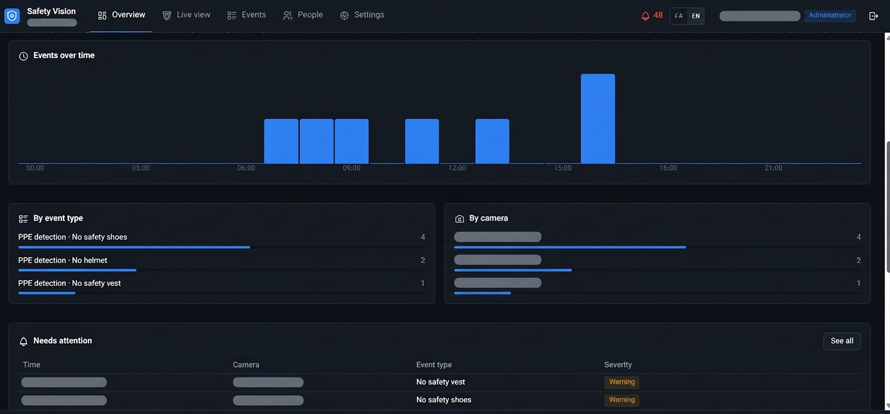 | 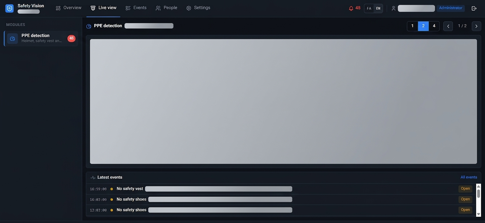 |
| 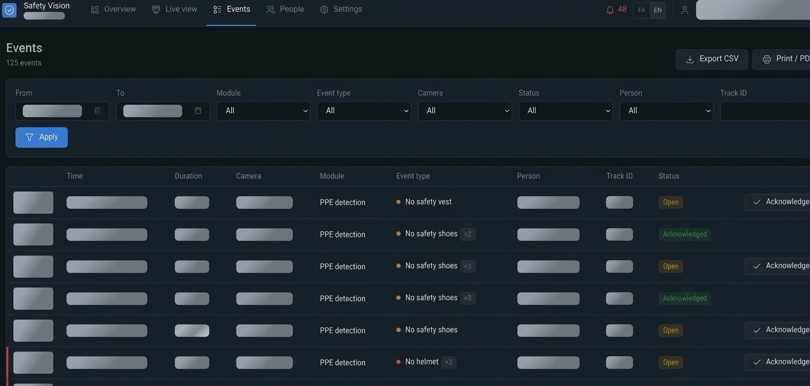 | 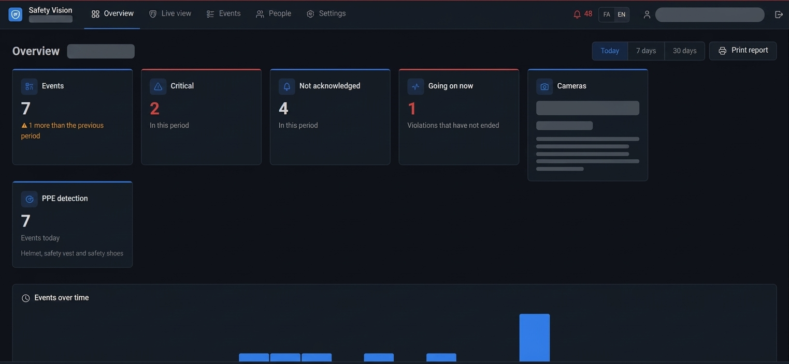 |
| 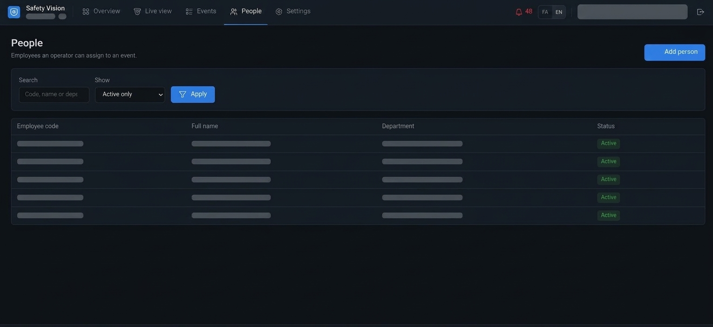 | 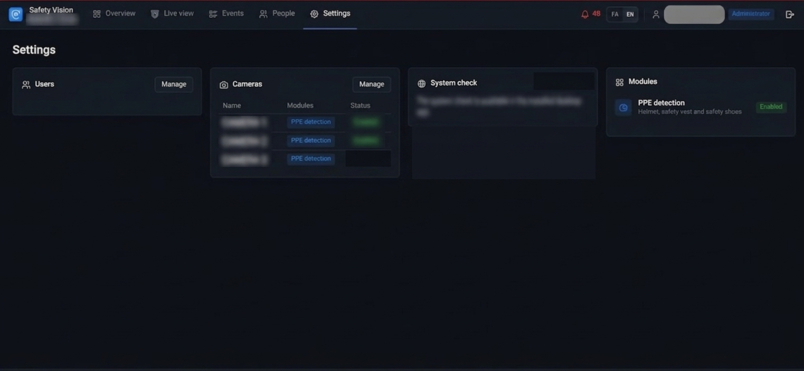 |

## Download and install

1. Download the installer from the [Releases](../../releases) page: the `gpu` build for computers with an NVIDIA GPU, otherwise the `cpu` build.
2. Check the file against `SHA256SUMS.txt`, then run it.
3. Add the models ([docs/models.md](docs/models.md)): download the general ones with one command and train your own PPE model. Models are not part of the installer or the repository.
4. Start **Safety Vision** from the desktop icon. On the first run it asks for the site name, the language and the administrator account.

Requirements: Windows 10 or 11 (64-bit), 8 GB RAM, several GB of free disk space. An NVIDIA GPU is strongly recommended; the CPU build is much slower. The installer is not code-signed, so Windows SmartScreen may warn you.

Full instructions: [User guide](docs/user_guide.md) · [راهنمای کاربر](docs/fa/user_guide.md)

## Architecture

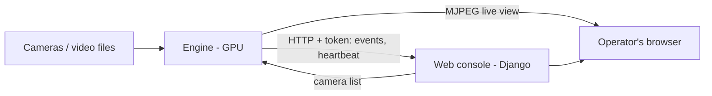

The engine does all video processing and never touches the database. The web app owns the database and only displays.
Details: [docs/architecture.md](docs/architecture.md) · contract: [docs/engine_api.md](docs/engine_api.md).

## Modules

| Module | What it checks | Docs |
|--------|----------------|------|
| `ppe` | Helmet, safety vest, safety shoes | [engine/modules/ppe](engine/modules/ppe/README.md) |

A new module is one class in the engine plus one entry in `web/apps/vision_modules/registry.py`
([how](docs/architecture.md)).

## For developers

```bash
git clone https://github.com/pooryakhorsand/safety-vision.git && cd REPO

# Web environment
python -m venv .venv-web && . .venv-web/bin/activate     # Windows: .venv-web\Scripts\activate
pip install -r requirements-dev.txt
python scripts/compile_translations.py      # Persian texts (not stored in git)
cp .env.example .env            # set DJANGO_SECRET_KEY (32+ characters) and ENGINE_API_TOKEN
cd web && python manage.py migrate && python manage.py runserver
```

Open http://127.0.0.1:8000. The first visit shows the setup page.

The engine uses its own environment (PyTorch, Ultralytics, BoxMOT):

```bash
python -m venv .venv-engine && . .venv-engine/bin/activate
pip install -r engine/requirements.txt
cp engine/config/engine.example.yaml engine/config/engine.yaml
python -m engine.tools.download_models        # general models; train your own PPE model (docs/models.md)
python -m engine.core.main run                 # live: cameras come from the web app
python -m engine.core.main offline --help      # analyse a video file
python -m engine.core.main replay --help       # play those results like a live camera
```

Tests and lint:

```bash
cd web && python manage.py test                # web
python -m pytest engine/tests desktop/tests -q # engine and desktop launcher
ruff check . && ruff format --check .
```

Building the Windows installer: see [desktop/](desktop/) and `.github/workflows/release.yml`.

## Configuration

| What | Where |
|------|-------|
| Secrets, database, ports | `.env` (see `.env.example`); installed app: `<data folder>\config\.env` |
| Engine: models, thresholds, timings | `engine/config/engine.yaml` (see `engine.example.yaml`) |
| Product name, logo, colour, language, retention, modules | `profiles/<name>/profile.yaml`, selected with `SITE_PROFILE` |
| Cameras | In the web console, **Settings → Cameras** |

Another customer or brand: copy `profiles/default/`, edit `profile.yaml` and the logo, set `SITE_PROFILE`.

## Privacy

- Stored: events (time, camera, type, snapshot of the violation), cameras, the people list an operator maintains, user accounts.
- Video is processed in memory and is not recorded by the engine. Only violation snapshots are saved.
- No biometric data is created. Repeat-violation merging uses short-term appearance matching that lasts minutes.
- Snapshots are served only to signed-in users and are deleted after `retention_days` (profile setting). The database is backed up daily with rotation.
- Everything stays on the machine. The app itself sends nothing out; only a model name without a file (for example `yolo11x.pt`) makes Ultralytics download it, and the installed app uses local files.

## Limitations

- Small or distant people, heavy overlap and very low light reduce accuracy; safety shoes are the hardest item.
- You train the PPE model yourself; accuracy depends on it, and no measured numbers are published.
- One engine per site; Windows is the supported desktop platform.

## Roadmap

- More vision modules (for example restricted-zone entry).
- Signed installers.

## License

<!-- TODO(owner): add LICENSE and name it here. Note: Ultralytics is AGPL-3.0. -->
See `LICENSE`.

## Acknowledgements

- [Ultralytics YOLO](https://github.com/ultralytics/ultralytics) (AGPL-3.0)
- [BoxMOT](https://github.com/mikel-brostrom/boxmot) (AGPL-3.0)
- [Django](https://www.djangoproject.com/) (BSD-3-Clause)
- [Vazirmatn](https://github.com/rastikerdar/vazirmatn) font (SIL OFL 1.1)
- [Tabler Icons](https://tabler.io/icons) (MIT)


