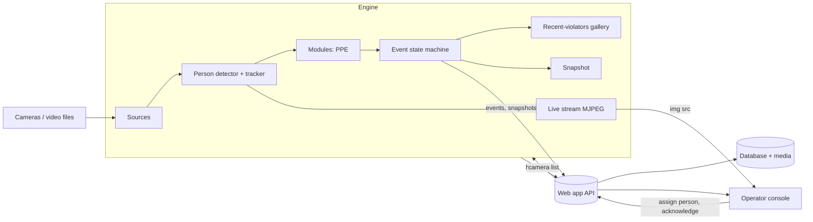

# Architecture

The system has two programs that talk over HTTP on the same machine, plus a launcher that starts them
when the product is installed as a desktop app.

| Part | Folder | Job |
|------|--------|-----|
| **Engine** | `engine/` | Reads the cameras and does **all** video processing: detection, tracking, rules, snapshots, live picture |
| **Web app** | `web/` | Django. Stores events, shows live views, lets operators handle events. **Never processes video** |
| **Launcher** | `desktop/` | Starts both, opens the window and keeps them running (installed app only) |

Why Django never touches video: decoding and inference need the GPU and run continuously. Keeping them
in their own process means a web page reload or a Django restart never drops frames, and the engine can
be updated, restarted or moved to another machine without touching the console.

## Data flow



Everything the engine sends goes through `engine/web_client/` and the API in [`engine_api.md`](engine_api.md).
The engine never opens the web app's database. The live picture is served by the engine on its own port;
the console just points an `` at it.

## Per-frame pipeline (engine)

1. A **source** delivers the latest frame of a camera (old frames are dropped, never queued).
2. The **person detector** and **tracker** give every person a stable track ID.
3. Each **module** looks at the frame and reports *observations* ("track 3 has no helmet right now").
   A module never sends, draws or creates events.
4. The shared **event state machine** turns observations into events (below).
5. Actions create, reopen or end events; a **snapshot** is attached; the **sink** sends them to the web app.

## Event lifecycle

```
violation seen ──► pending ──(lasts confirm_seconds)──► open ──(gone for clear_seconds)──► ended
                      │                                   ▲                                  │
                      └─ blinks shorter than              └──── same person again within ────┘
                         pending_grace_seconds                  merge_window_minutes: reopen
                         do not restart the timer               the same event, occurrences + 1
```

- One event = one violation over a period of time, identified by a `uid` chosen by the engine.
  Sending the same `uid` again updates the same row, so retries are safe.
- If the web app is down, events wait in a queue on disk and are delivered in order when it is back.

## Repeat violations of one person

A person who takes their helmet off five times in ten minutes should be one event with `occurrences = 5`,
not five events. When an event ends, the engine keeps the person's appearance (a ReID embedding) in the
**recent-violators gallery**. If someone with a similar appearance violates the same rule again within
`events.merge_window_minutes`, on the same or a neighbouring camera, and nobody matching is visible at that
moment, the engine reopens the old event.

This is meant for minutes inside a shift. It is not an identity system: the engine holds no names and
no biometric templates beyond these short-lived embeddings.

## Who is this?

The engine never sends a name. An operator opens an event and picks the employee from the list
(`people` app). Every change is kept in a history table (who, when, from, to).

## Live state

The engine posts a heartbeat every few seconds (version, GPU memory, per-camera online state and FPS,
whether the model files were found). The web app keeps the latest one in a cache; no heartbeat for
`ENGINE_HEARTBEAT_TIMEOUT_SECONDS` shows the engine as offline. Footage played from a recording is
reported with `mode: replay` and shown with a "Recorded" badge.

## Where things are stored

| What | Development | Installed app (`APP_DATA_DIR`) |
|------|-------------|--------------------------------|
| Settings (`.env`, `engine.yaml`) | project folder | `config/` |
| Database | `web/db.sqlite3` | `db/db.sqlite3` |
| Snapshots, clips | `data/media/` | `media/` |
| Backups | `data/backups/` | `backups/` |
| Logs | `data/logs/` | `logs/` |
| Model files | any path in `engine.yaml` | `models/` |
| Engine send queue | `data/engine_queue/` | `queue/` |

## Adding a module

A module analyses frames and reports observations. The state machine, snapshots, API and console already
exist, so a new module only needs three things:

1. **Engine:** `engine/modules/<key>/module.py` with a class that extends `VisionModule`
   (`engine/modules/base.py`), decorated with `@register_module`, and imported in
   `engine/modules/__init__.py`. Declare `required_detectors` if it needs a model beyond the person detector.
   Return one `Observation` per person and event type, with `active=True` while the violation is happening.
2. **Web:** add a `VisionModule` entry with the same key and its event types to
   `web/apps/vision_modules/registry.py`, and add the key to `enabled_modules` in the profile
   (`profiles/<name>/profile.yaml`).
3. **Text and tests:** add the Persian translations to `web/locale/fa/LC_MESSAGES/django.po`
   (then `python scripts/compile_translations.py`), add the module to the table in `engine_api.md`, and add
   tests in `engine/tests/`. Tests use scripted detectors from `engine/tests/fakes.py`, so they need no GPU.

No template needs to change: the sidebar, overview cards, filters and settings page are built from the registry.
